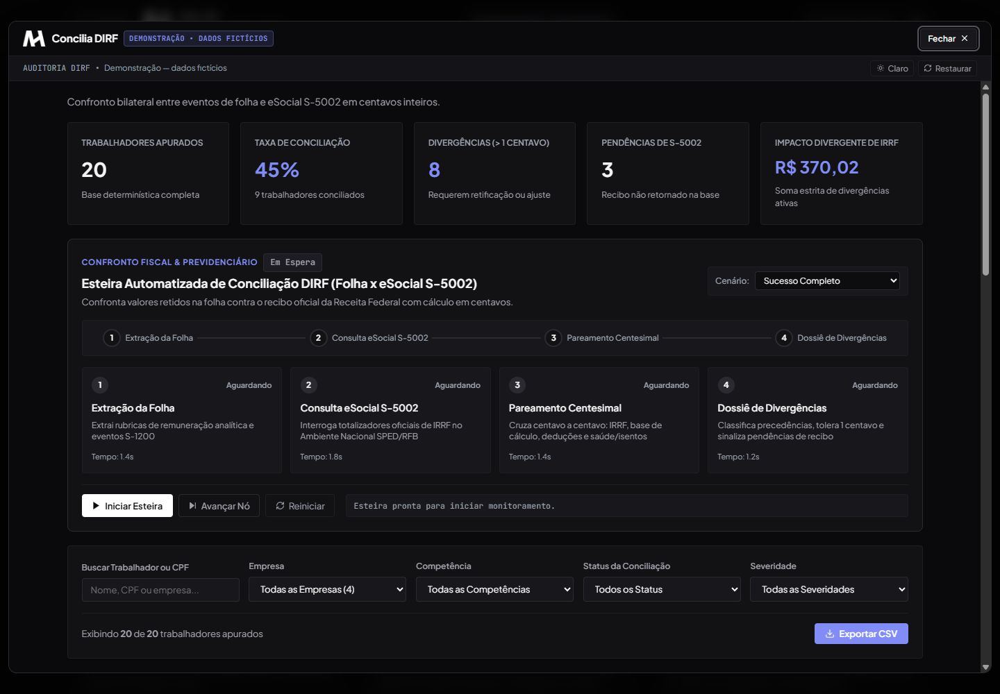

# AH Concilia DIRF

*Captura da demonstração — dados fictícios.*

**Desafio:** comparar informações da folha e retornos S-5002, separando divergências monetárias de pendências de informação.

**Experiência:** animação da extração da folha, comparação, classificação de divergências e relatório filtrável com detalhes por registro.

**Explore:** filtre as classificações, confira a composição dos valores e compare uma divergência com um retorno S-5002 pendente.

**Aspecto técnico:** valores são comparados em centavos inteiros. A ausência de retorno permanece pendência, sem conversão indevida para valor zero.

**Benefício demonstrado:** organizar a triagem e mostrar o motivo de cada classificação antes da revisão humana.

[Abrir demonstração](https://ah-automacoes-demo.vercel.app/concilia-dirf) · [Voltar aos casos](../README.md)

*Demonstração — dados fictícios. Sem acesso à folha, bancos operacionais ou eSocial.*
