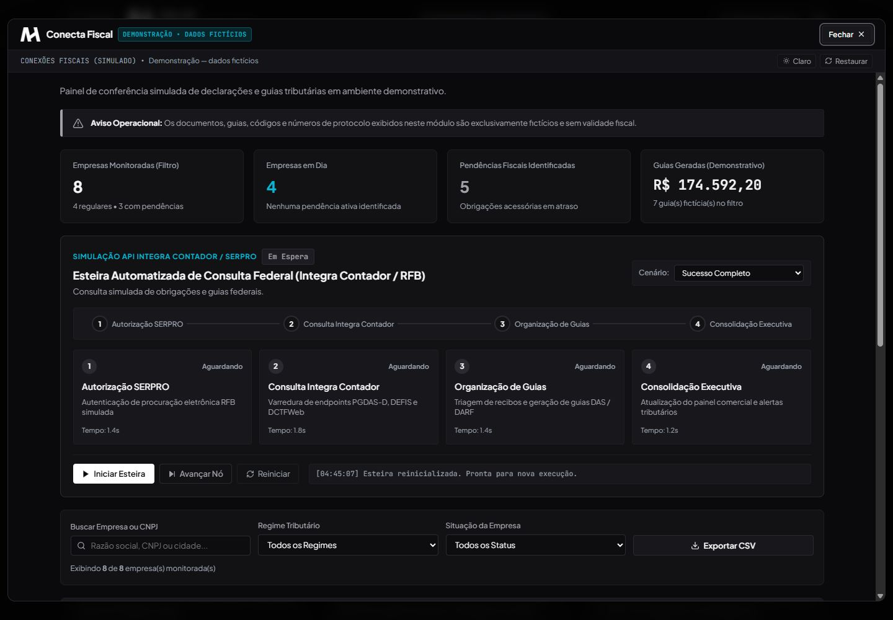

# AH Conecta Fiscal

*Captura da demonstração — dados fictícios.*

**Desafio:** apresentar consultas, obrigações e pendências de várias empresas em uma interface compreensível para a operação.

**Experiência:** painel de empresas com obrigações e guias fictícias. Uma consulta animada mostra etapas de processamento, resultado e histórico simulado.

**Explore:** selecione um recorte de empresas, inicie a consulta e experimente o cenário de falha recuperável antes de tentar novamente.

**Aspecto técnico:** uma máquina de estados no navegador controla avanço, pausa, conclusão e recuperação. Os resultados usam registros locais.

**Benefício demonstrado:** dar visibilidade ao andamento de uma consulta e organizar a revisão de pendências em um único fluxo.

[Abrir demonstração](https://ah-automacoes-demo.vercel.app/conecta-fiscal) · [Voltar aos casos](../README.md)

*Demonstração — dados fictícios. Sem acesso ao SERPRO, Receita Federal ou emissão de guias válidas.*
