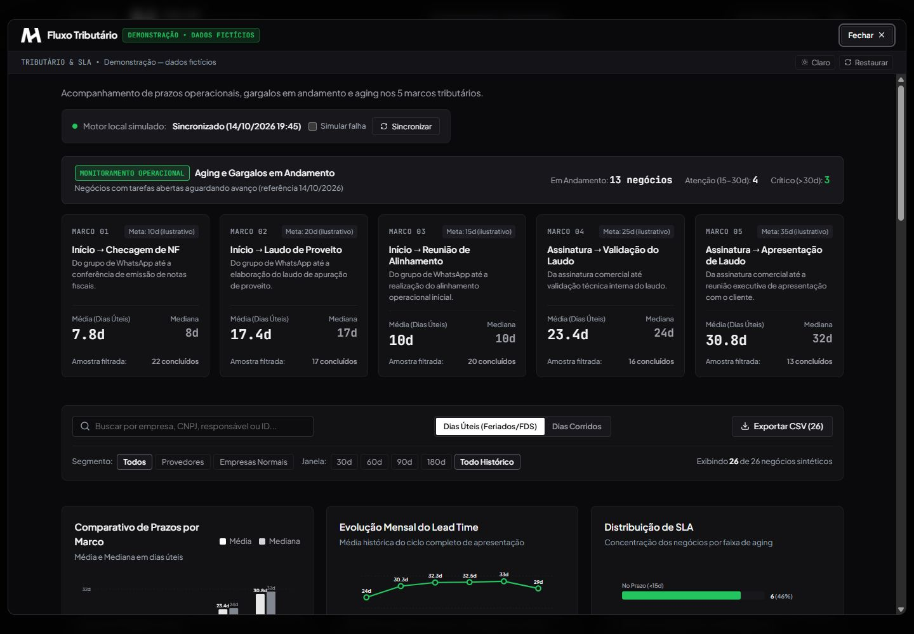

# AH Fluxo Tributário

*Captura da demonstração — dados fictícios.*

**Desafio:** enxergar prazos, dispersão e gargalos de uma rotina a partir de registros detalhados.

**Experiência:** painel com indicadores de prazo, média e mediana, evolução mensal, segmentação e comparação entre dias úteis e corridos. A tabela permite conferir os registros que compõem a leitura.

**Explore:** combine período e segmento, confira os indicadores e exporte os resultados filtrados em CSV.

**Aspecto técnico:** filtros e métricas partem de um conjunto determinístico de dados fictícios. A interface permite confrontar o resumo com o detalhe.

**Benefício demonstrado:** tornar o acompanhamento de prazos mais legível e facilitar a identificação de pontos que merecem análise.

[Abrir demonstração](https://ah-automacoes-demo.vercel.app/fluxo-tributario) · [Voltar aos casos](../README.md)

*Demonstração — dados fictícios. Sem acesso a processos ou dados de clientes.*
